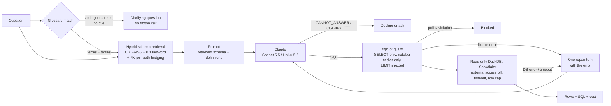

# Text-to-SQL Assistant

[](https://github.com/sainithya-2001/text-to-sql-assistant/actions/workflows/ci.yml)

Ask questions about sales data in plain English and get back a validated, read-only SQL query and its
results. Built on DuckDB's TPC-H dataset (generated locally, no downloads or credentials) with an
optional Snowflake backend, schema retrieval over FAISS, a business glossary, and Claude for SQL
generation. Measured with a 60-question execution-accuracy eval (results below).

This is v2 of a [Dify + Snowflake prototype](#from-prototype-to-v2) I built earlier; the original
workflow exports are kept, sanitized, in [`prototype-sanitized/`](prototype-sanitized/).

A real answer from the eval run (Sonnet 5.5, retrieved schema + glossary). The question never defines
"revenue"; the glossary does, and it also pulled `lineitem` and `orders` into the retrieved schema:

```
Q: What was our revenue in each customer region in 1995?

SELECT r.r_name AS region, SUM(l.l_extendedprice * (1 - l.l_discount)) AS revenue
FROM lineitem l
JOIN orders o ON l.l_orderkey = o.o_orderkey
JOIN customer c ON o.o_custkey = c.c_custkey
JOIN nation n ON c.c_nationkey = n.n_nationkey
JOIN region r ON n.n_regionkey = r.r_regionkey
WHERE o.o_orderdate >= DATE '1995-01-01' AND o.o_orderdate < DATE '1996-01-01'
GROUP BY r.r_name
ORDER BY revenue DESC
```

## Architecture



| Piece | What it does | Where |
|---|---|---|
| Backend | DuckDB TPC-H (sf=0.01, built in ~2 s with the `tpch` extension) or Snowflake `SNOWFLAKE_SAMPLE_DATA.TPCH_SF1` | [`db/`](src/text_to_sql/db/) |
| Catalog | Live columns + hand-written business descriptions + FK graph | [`schema/catalog.py`](src/text_to_sql/schema/catalog.py), [`descriptions.py`](src/text_to_sql/schema/descriptions.py) |
| Retrieval | One document per table and per column, embedded with bge-small (fastembed); keyword half matches table names and aliases; top-k tables closed over the FK graph | [`schema/retriever.py`](src/text_to_sql/schema/retriever.py) |
| Glossary | Business terms → definitions, SQL and tables; ambiguous terms → clarifying question | [`glossary.yaml`](glossary.yaml), [`schema/glossary.py`](src/text_to_sql/schema/glossary.py) |
| Generation | Claude at low effort, schema in the system prompt (cached in full-schema mode), SQL-only output contract | [`llm/`](src/text_to_sql/llm/) |
| Guard | sqlglot AST checks; rejects writes, multi-statements, table functions, system schemas and functions | [`safety/guard.py`](src/text_to_sql/safety/guard.py) |
| Pipeline | Orchestration, one self-correction retry | [`pipeline.py`](src/text_to_sql/pipeline.py) |
| Eval | Execution accuracy over 60 questions, model × schema mode × glossary | [`eval/`](eval/), [`evaluation.py`](src/text_to_sql/evaluation.py) |

## Quickstart

```bash
python -m venv .venv && source .venv/bin/activate      # Windows: .venv\Scripts\activate
pip install -e ".[embed,ui]"
cp .env.example .env                                   # add ANTHROPIC_API_KEY
t2s init-db                                            # generate data/tpch.duckdb

t2s ask "Which 5 nations had the most orders placed in 1996?"
t2s ask "Who are our biggest customers?"               # asks what "biggest" means
t2s ask "Who are our biggest customers?" --choose "biggest customers=by revenue"
t2s chat                                               # interactive, $0.25 session cap
t2s check-sql "DELETE FROM orders"                    # guard only: no LLM, no execution
streamlit run app/streamlit_app.py                     # UI on :8501
```

Docker (the image contains the database and the embedding model):

```bash
docker build -t text-to-sql .
docker run --rm -p 8501:8501 --env-file .env text-to-sql
docker run --rm --env-file .env text-to-sql t2s ask "How many orders were placed in 1995?"
```

Snowflake: install `.[snowflake]`, set `T2S_BACKEND=snowflake` and the four `SNOWFLAKE_*` variables in
`.env` (see [`.env.example`](.env.example)). The sample database is a read-only share, and the same
guard applies.

## Safety

Generated SQL passes three independent layers before and during execution:

1. **sqlglot guard** (allowlist where possible). Exactly one statement; the root must be a SELECT or a
   set operation; no write, DDL, `COPY`, `PRAGMA`, `ATTACH`, `SET` or `SELECT INTO` node anywhere in the
   tree (including data-modifying CTEs). Every table reference must be a catalog table or a CTE, which
   rejects table functions (`read_csv`, `duckdb_settings()`, `query()`), quoted file paths and
   `information_schema`. Server-state functions (`getenv`, `current_setting`, `version()`) are denied by
   name. A CTE name only counts where that CTE is in scope, and DuckDB's own parser must also see
   exactly one SELECT (both found by the safety study below). A `LIMIT` is added when missing.
2. **Locked-down connection.** DuckDB opens read-only with `enable_external_access=false` and
   `lock_configuration=true`. The first stops writes; the second stops `SELECT * FROM read_csv('/etc/passwd')`,
   which a read-only connection alone would allow and which *is* a SELECT; the third stops SQL from
   undoing either.
3. **Execution limits.** Timeout via `interrupt()`, row cap with truncation flag.

Policy violations are **blocked, not retried**: a `DELETE` is never handed back to the model to "fix".
Fixable failures (unknown column, parse error, timeout) get one repair turn with the error message.
Asked to delete orders, both models declined before the guard was needed (`CANNOT_ANSWER: I can only
write read-only SELECT queries`) in a live check; the guard is the deterministic backstop.

**Do these layers actually work?** [`safety_eval/`](safety_eval/README.md) tests them against 100
hand-written attacks and 2,253 fuzzed variants on disposable databases, measuring harm from the
database itself. The original guard + read-only connection stopped 86 of 91 non-DoS attacks; the rest
traced to a CTE scoping bug and a PIVOT parser mismatch. Both are now fixed in `SqlGuard`, which
stops all 91 attacks and all fuzzed variants at no measured cost to legitimate queries. Write-up:
[`safety_eval/RESULTS.md`](safety_eval/RESULTS.md).

## Eval

**Metric: execution accuracy.** A prediction is correct when its result set matches the gold query's:
same rows as a multiset (or in order, when the question asks for an order), column names and order
ignored, numbers compared to 2 decimal places. Every gold query runs in the test suite, and a test checks
that no "top N" question has a tie at the cutoff, or inside the top N when order matters. Without that
check, equally correct queries return different rows; the smoke test hit exactly this.

**Question sets** ([`eval/`](eval/)):
- **Core (40):** 14 easy, 14 medium, 12 hard, from single-table counts to 6-table TPC-H-style analytics.
  Each question names its output columns and spells out its metric ("revenue, the sum of extended price
  times (1 - discount)").
- **Glossary (12):** the same kind of question using business terms *without* defining them ("revenue",
  "late shipments", "lifetime value").
- **Ambiguity (8):** 5 should get a clarifying question ("Who are our biggest customers?"), 3 contain a
  cue that settles the meaning and should be answered ("top 5 customers by revenue").

Settings: effort `low`, top-k 4, one run per configuration.

### Core set: 40 questions, metrics spelled out in the question

| Model | Schema | Glossary | Easy | Medium | Hard | **Accuracy** | Retries | $ / question | Avg latency |
|---|---|---|---|---|---|---|---|---|---|
| Haiku 5.5 | full | off | 100% (14/14) | 100% (14/14) | 100% (12/12) | **100% (40/40)** | 0 | $0.0001 | 1.1s |
| Haiku 5.5 | retrieved | off | 100% (14/14) | 100% (14/14) | 92% (11/12) | **98% (39/40)** | 1 | $0.0003 | 1.2s |
| Haiku 5.5 | retrieved | on | 100% (14/14) | 100% (14/14) | 92% (11/12) | **98% (39/40)** | 0 | $0.0003 | 1.2s |
| Sonnet 5.5 | full | off | 100% (14/14) | 100% (14/14) | 100% (12/12) | **100% (40/40)** | 0 | $0.0021 | 1.6s |
| Sonnet 5.5 | retrieved | off | 100% (14/14) | 100% (14/14) | 92% (11/12) | **98% (39/40)** | 1 | $0.0055 | 1.6s |
| Sonnet 5.5 | retrieved | on | 100% (14/14) | 100% (14/14) | 100% (12/12) | **100% (40/40)** | 1 | $0.0059 | 1.7s |

### Glossary set: 12 questions using undefined business terms

| Model | Schema | Glossary | **Accuracy** | Retries | $ / question | Avg latency |
|---|---|---|---|---|---|---|
| Haiku 5.5 | full | off | **58% (7/12)** | 0 | $0.0002 | 1.6s |
| Haiku 5.5 | full | on | **100% (12/12)** | 0 | $0.0002 | 1.4s |
| Haiku 5.5 | retrieved | off | **42% (5/12)** | 0 | $0.0003 | 1.6s |
| Haiku 5.5 | retrieved | on | **100% (12/12)** | 0 | $0.0003 | 1.6s |
| Sonnet 5.5 | full | off | **75% (9/12)** | 3 | $0.0035 | 2.1s |
| Sonnet 5.5 | full | on | **100% (12/12)** | 0 | $0.0030 | 1.8s |
| Sonnet 5.5 | retrieved | on | **100% (12/12)** | 0 | $0.0063 | 1.6s |

### Ambiguity set: 5 should get a clarifying question, 3 have a cue and should be answered

| Model | Schema | Glossary | **Accuracy** | Retries | $ / question | Avg latency |
|---|---|---|---|---|---|---|
| Haiku 5.5 | full | off | **25% (2/8)** | 0 | $0.0002 | 2.0s |
| Haiku 5.5 | full | on | **100% (8/8)** | 0 | $0.0000 | 0.6s |
| Haiku 5.5 | retrieved | off | **25% (2/8)** | 0 | $0.0004 | 2.0s |
| Haiku 5.5 | retrieved | on | **100% (8/8)** | 0 | $0.0001 | 0.6s |
| Sonnet 5.5 | full | off | **25% (2/8)** | 2 | $0.0034 | 2.2s |
| Sonnet 5.5 | full | on | **100% (8/8)** | 0 | $0.0009 | 0.7s |
| Sonnet 5.5 | retrieved | on | **100% (8/8)** | 0 | $0.0026 | 0.7s |

Spend for these runs: **$0.792** (each run had its own hard cap).

The glossary-off ambiguity rows are a baseline, not a fair contest: with the glossary off, the
`CLARIFY` instruction is off too, so the model has no way to ask.

### Retrieval recall (offline, no API calls)

Share of questions whose gold tables were all in the schema sent to the model
([`eval/retrieval_recall.py`](eval/retrieval_recall.py), 55 questions with gold SQL, bge-small):

| Glossary tables | k=3 | k=4 | k=5 | k=6 |
|---|---|---|---|---|
| no | 93% (51/55), 3.3 tables | 95% (52/55), 4.1 tables | 96% (53/55), 5.2 tables | 100% (55/55), 6.0 tables |
| yes | 95% (52/55), 3.3 tables | 98% (54/55), 4.2 tables | 98% (54/55), 5.2 tables | 100% (55/55), 6.0 tables |

### What the results say

1. **On an 8-table schema, the full schema wins.** Both models score 100% with the full schema. With
   retrieval, the single miss is h05, the one question that needs 6 tables; top-4 retrieval dropped
   `orders` and `region`. Full schema is also *cheaper* for Sonnet ($0.0021 vs $0.0055 per question),
   because the full-schema prompt is identical every time and served from the prompt cache, while
   per-question retrieved prompts can't be. Retrieval earns its place when the schema is too large or
   changes too often to cache; on TPC-H it doesn't, and the eval says so.
2. **Haiku 5.5 matches Sonnet 5.5 on the core set at about 1/20 the cost** ($0.0001-0.0003 vs
   $0.0021-0.0059 per question) and is a little faster. For well-specified questions over a
   well-described schema, the smaller model is enough.
3. **Business definitions matter more than model size.** Without the glossary, Sonnet gets 75% and
   Haiku 42-58% of the business-term questions. With it, every configuration tested gets 100%. Without
   definitions the models wrote reasonable SQL for a *different* metric:
   - "late shipment": ship date after commit date, instead of receipt date after commit date
   - "lifetime value": sum of order totals, instead of discounted revenue
   - "high-priority orders": only `2-HIGH`, missing `1-URGENT`
   - "shipping time": ship-to-receipt, instead of order-to-ship
   - "on-time rate": a 0-1 fraction where the glossary specifies a 0-100 percentage

   Some of these are conventions rather than mistakes. Either way, the definition is a business
   decision, and `glossary.yaml` is where it gets made.
4. **Asking beats guessing, and it's free.** Ambiguous glossary terms are caught before any model call
   (0.6 s, $0). The model's own `CLARIFY` path handled the one ambiguous question outside the glossary
   ("Which region is performing best?"). With retrieval, its clarifying question offered only supplier
   metrics, because retrieval had picked supplier tables: the schema shown shapes even the question
   back. With the glossary on, none of the 40 core questions triggered a false clarification.
5. **Retrieval misses mostly became declines, not hallucinations.** Of the 6 runs where retrieval
   missed a gold table, 4 answered `CANNOT_ANSWER` and named the missing tables. In one, Haiku without the
   glossary answered "revenue" with `SUM(o_totalprice)` from the `orders` table it *was* given: a
   plausible substitute, wrong metric. The sixth is the case below. None invented a column.
6. **A correct answer for the wrong reason.** With the glossary on, Sonnet answered h05 without the
   `region` table in its prompt by hardcoding `n_regionkey = 2`, ASIA's key in TPC-H. The result
   matches, so execution accuracy counts it correct. But the key came from the model having seen TPC-H
   (a public benchmark) in training, not from the schema. On a private schema this would have been a
   decline. Public-benchmark evals overstate accuracy in ways this metric can't see.
7. **The eval found bugs, not just scores.** It surfaced a sqlglot `TokenError` (a different exception
   class from `ParseError`) that let an unterminated string in model output escape the guard and kill
   the run. The guard now treats any sqlglot error as a fixable failure, and the runner records a crash
   as a failed item instead of stopping.

**Limits of this eval:** 60 questions, one run each, so a single question moves a row by 2.5-12.5 points
and run-to-run variance isn't measured. All questions are in English over one schema the models have
probably seen.

**Cost.** The three eval runs cost **$0.79**. The whole project's API spend, including smoke tests and the
pilot, was about **$0.87** against a $1.00 cap. A `BudgetGuard` refuses any call whose projected cost
would cross the cap; the projection errs high, learning each model's tokens per character and largest
output.

Reproduce:

```bash
t2s eval --pilot 6 --budget 0.10                       # 6 questions x 4 configs, prints a cost projection
t2s eval --name core_baseline --modes full,retrieved --glossary off
t2s eval --questions glossary_questions.yaml,ambiguous_questions.yaml --glossary both --name glossary_sets
python eval/report.py                                  # tables above, from eval/results/*.json
python eval/retrieval_recall.py                        # retrieval table, no API calls
```

## From prototype to v2

The first version was a Dify workflow on Snowflake (Nov 2025). Four exports show how it evolved:
from routing on a Dify user ID with an LLM classifier, to a username/password gate, to a deterministic
per-user router with a second login check before execution. Full write-up: [`docs/prototype.md`](docs/prototype.md).

| | Prototype (Dify) | v2 |
|---|---|---|
| Schema context | Dify knowledge base, hybrid retrieval 0.7 vector / 0.3 keyword | FAISS over generated table/column docs, same 0.7 / 0.3 hybrid weighting |
| SQL rules | "Output only SQL", "no context → no SQL", ANSI joins | Same rules, plus `CANNOT_ANSWER` and `CLARIFY` as explicit outputs |
| Safety | An LLM classifier decided whether SQL was a SELECT | sqlglot AST guard + read-only, locked-down connection |
| Access control | Passwords hardcoded in IF/ELSE nodes; SQL tool duplicated per user | No credentials in code; access control belongs to database roles |
| Errors | One bad column name ended the conversation | One repair turn with the database error |
| Business terms | Implicit in KB documents | `glossary.yaml` with definitions, SQL and clarifying questions |
| Measurement | None | 60-question execution-accuracy eval with cost tracking |

Publishing the prototype meant scanning it first: the exports contained login passwords in IF/ELSE
conditions, Dify user IDs and knowledge-base IDs, but no API keys or Snowflake credentials (those
lived in the Dify workspace). The originals are gitignored;
[`scripts/check_sanitized.py`](scripts/check_sanitized.py) runs in CI and fails on any password
condition with a literal value, user ID or dataset ID.

## Business glossary

[`glossary.yaml`](glossary.yaml) maps the words people use to exact definitions:

```yaml
- term: late shipment
  synonyms: [late delivery, late deliveries, delivered late, delayed shipment, ...]
  definition: A line item the customer received after the date the supplier committed to.
  sql: l_receiptdate > l_commitdate
  tables: [lineitem]

- term: biggest customers
  synonyms: [top customers, best customers, largest customers, ...]
  clarify: When you say biggest customers, how should they be ranked?
  interpretations:
    - label: by revenue
      cues: [revenue, sales, spend, spent, value, lifetime]
      ...
```

Matching is on word stems (numbers ignored, so "top 5 customers" matches "top customers"; the longest
phrase wins, so "gross revenue" beats "revenue"). A matched term adds its tables to the retrieved set
and its definition to the user turn. Definitions go in the user turn, not the system prompt, so the
system prompt stays byte-identical and full-schema prompt caching keeps working. An ambiguous term
with no cue word returns a clarifying question **before any model call**; a cue ("top customers *by
revenue*") or an explicit `--choose` resolves it. The model can also reply `CLARIFY:` for ambiguity the
glossary doesn't cover.

## Configuration

| Variable | Default | |
|---|---|---|
| `ANTHROPIC_API_KEY` | | required for generation |
| `T2S_MODEL` | `claude-sonnet-5-5` | or `claude-haiku-5-5` |
| `T2S_EFFORT` | `low` | thinking effort |
| `T2S_TOP_K` | `4` | tables retrieved before join bridging |
| `T2S_MAX_ROWS` / `T2S_TIMEOUT_S` | `200` / `15` | execution limits |
| `T2S_EMBEDDER` | `fastembed` | `hash` = offline, used in tests/CI |
| `T2S_GLOSSARY` | `on` | `off` disables the glossary |
| `T2S_BACKEND` | `duckdb` | `snowflake` needs `SNOWFLAKE_*` |

## Development

```bash
pip install -e ".[dev,ui]"
pytest            # offline: no API key, no network beyond the DuckDB tpch extension
ruff check . && ruff format --check .
```

Tests use a fake LLM, a hashing embedder and a temporary TPC-H database, and never read `.env`. CI
runs them on Linux and Windows, checks the sanitized prototype exports, and builds and smoke-tests the
Docker image.

## Limitations

- TPC-H has 8 tables, so the full schema fits easily in a prompt. Retrieval here is about cost and
  focus; it matters more on schemas with hundreds of tables, where this eval would need re-running.
- Execution accuracy ignores column names and order and rounds to 2 decimals. It can't see a query
  that's right for the wrong reason, or one that returns extra columns the question didn't ask for.
- The glossary is hand-curated and matched lexically; a term phrased in a way none of its synonyms
  cover won't match (the model's `CLARIFY` path is the fallback).
- The Snowflake backend is implemented but has not been run against a live account in this repo's CI.
